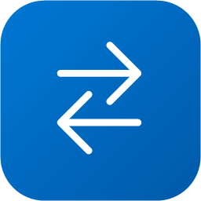
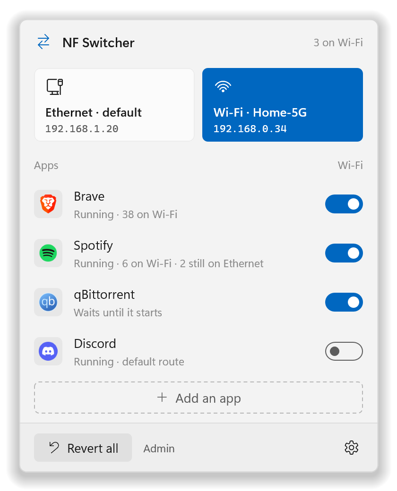
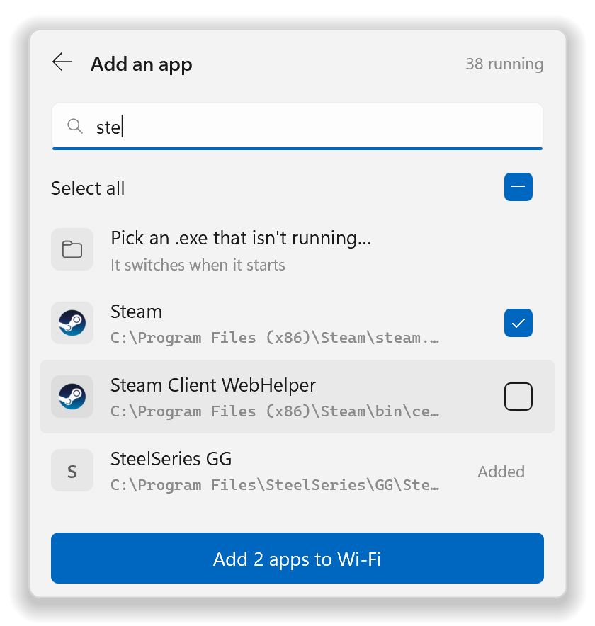
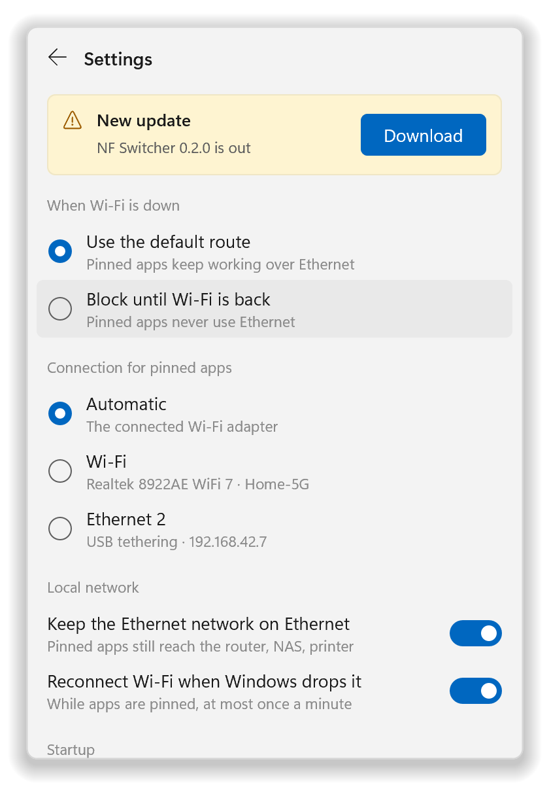
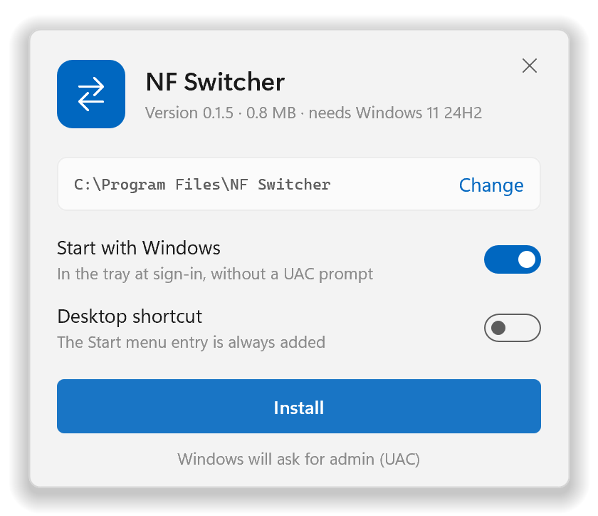

<div align="center">



# NF Switcher

**Choose which apps use Wi-Fi. Everything else stays on Ethernet.**

[](https://github.com/Nasseralenezd/nf-switcher/releases/latest)
[](https://github.com/Nasseralenezd/nf-switcher/releases)


[](https://github.com/Nasseralenezd/nf-switcher/releases/latest)

[Features](#features) · [Install](#install) · [How to use](#how-to-use) · [FAQ](#faq) · [How it works](#how-it-works)

<picture>
  <source media="(prefers-color-scheme: dark)" srcset="docs/images/hero-dark.png">
  
</picture>

</div>

NF Switcher sits in the tray next to the clock. Add an app, flip its switch, and that app goes online over **Wi-Fi**
while everything else keeps using **Ethernet**. Put your browser or a big download on Wi-Fi and your games keep
the wired connection to themselves.

## Features

- **One switch per app.** Wi-Fi or Windows' default route (Ethernet). Add any running program, or pick an `.exe`.
- **Works right away.** New connections move the moment you flip the switch, even while the app is running.
  Apps you start later are covered too.
- **Remembers your choices.** Starts with Windows in the tray and applies them again, without a UAC prompt.
- **Nothing permanent.** Uses Windows' own connection rules. Quit, **Revert all** or even a crash puts Windows back
  the way it was.
- **Ready for Wi-Fi drops.** Pinned apps fall back to Ethernet, or wait until Wi-Fi is back: your choice. It can
  reconnect Wi-Fi when Windows drops it.
- **Keeps your home network in reach.** Your router's page, a NAS or a printer on the Ethernet side still work from
  pinned apps.
- **Small.** About 2 MB of memory in the tray. No driver and no service to install.
- **Light and dark.** Follows Windows' mode, with the Windows 11 look.
- **Update notice.** A dot on the Settings gear when a new version is out.

## Screenshots

<table>
  <tr>
    <th>Add an app</th>
    <th>Settings</th>
    <th>Installer</th>
  </tr>
  <tr>
    <td valign="top">
      <picture>
        <source media="(prefers-color-scheme: dark)" srcset="docs/images/add-dark.png">
        
      </picture>
    </td>
    <td valign="top">
      <picture>
        <source media="(prefers-color-scheme: dark)" srcset="docs/images/settings-dark.png">
        
      </picture>
    </td>
    <td valign="top">
      <picture>
        <source media="(prefers-color-scheme: dark)" srcset="docs/images/setup-options-dark.png">
        
      </picture>
    </td>
  </tr>
</table>

<sub>Screenshots show sample data.</sub>

## Install

1. Download **`NF-Switcher-Setup-<version>.exe`** from the
   [latest release](https://github.com/Nasseralenezd/nf-switcher/releases/latest).
2. Run it, choose your options and click **Install**. Windows asks for admin once.
3. NF Switcher opens in the tray. Click its icon to get started.

The installer puts NF Switcher in `C:\Program Files\NF Switcher` for everyone on the PC, adds it to Start and to
Settings › Apps › Installed apps, and (unless you switch it off) starts it with Windows. Running a newer setup
updates in place and keeps your settings.

> [!NOTE]
> The setup isn't code-signed yet, so Windows SmartScreen may say it "protected your PC". Click **More info** ›
> **Run anyway**. The release page lists the file's SHA-256 if you'd like to check your download
> (`Get-FileHash .\NF-Switcher-Setup-<version>.exe`).

### Requirements

- Windows 11, version 24H2 or later, 64-bit (a free update for PCs that meet Windows 11's requirements, see the
  [FAQ](#faq))
- Wi-Fi plus a second connection, usually Ethernet (a phone's USB tethering works in place of Wi-Fi too)
- An admin account (see [Why does it need admin?](#faq))

## How to use

1. **Click the tray icon.** The flyout shows Ethernet and Wi-Fi with their addresses, and your apps.
2. **Add an app.** Tick the running programs you want (or **Select all**) and click **Add N apps to Wi-Fi**, or
   **Pick an .exe that isn't running…**
3. **Switch it on.** Its new connections go over Wi-Fi. Each app shows how many of its connections are on Wi-Fi.

Good to know:

- Connections an app opened *before* you switched it keep their route until it reconnects. Restart the app, or
  right-click it › **Move its open connections now**.
- **Revert all** puts every app back on the default route and removes everything NF Switcher added to Windows.
  Your list stays, so switching an app back on is one click.
- **Quit** (right-click the tray icon) does the same for Windows but keeps your choices for next time.
- Right-click an app to remove it from the list.

## Settings

| Setting | What it does | Default |
| --- | --- | --- |
| **When Wi-Fi is down** | *Use the default route*: pinned apps keep working over Ethernet.<br>*Block until Wi-Fi is back*: pinned apps never use Ethernet. | Use the default route |
| **Connection for pinned apps** | *Automatic* uses the connected Wi-Fi. Or pick an adapter, for example a phone's USB tethering. | Automatic |
| **Keep the Ethernet network on Ethernet** | Pinned apps still reach your router, NAS or printer on the Ethernet side. Only matters when Wi-Fi and Ethernet are different networks. | On |
| **Reconnect Wi-Fi when Windows drops it** | While apps are pinned, connects Wi-Fi again with the network Windows already knows, at most once a minute. | On |
| **Start with Windows** | Starts NF Switcher in the tray when you sign in, without a UAC prompt. | On |
| **Check for updates** | Asks GitHub once, when NF Switcher starts, whether a new version is out. | On |

## Updates

NF Switcher looks for a new release once, 20 seconds after it starts (with Start with Windows, that's once per
sign-in): one HTTPS request to GitHub's API. It doesn't check again while it keeps running; switching **Check for
updates** off and on checks right away. When a new version is out, the Settings gear gets a dot and Settings shows
**New update** with an **Update now** button:

1. NF Switcher downloads the new setup from the release (no browser), showing its progress on the card.
2. It checks the file's size and SHA-256 against what GitHub lists for it, and keeps it in its own admin-only folder,
   locked, so nothing can swap it before it runs. A file that doesn't match is never used.
3. The setup updates NF Switcher in place with your current choices (no options, no UAC prompt, because NF Switcher
   already runs as admin), then opens the new version. Pinned apps use Ethernet for those few seconds.

Without admin, or if the download fails, the button is **Download** instead: it opens the release page in your
browser, and the setup you download there updates in place too.

## Uninstall

Settings › Apps › Installed apps › **NF Switcher** › **Uninstall**. It closes NF Switcher (which takes its rules out of
Windows), removes the sign-in task, shortcuts and files, and, if you tick the box, your settings too.

To uninstall from a script: `"C:\Program Files\NF Switcher\uninstall.exe" --uninstall --quiet`

## FAQ

<details>
<summary><b>Why does it need admin?</b></summary>

Sending an app over a different connection means adding rules to the Windows Filtering Platform and switching on
Windows' "Route Policies" option, and both need admin rights. With **Start with Windows** on, a sign-in task starts
NF Switcher with admin rights, so you don't get a UAC prompt every time. If you say No to the prompt, NF Switcher
still opens, read-only, with a **Restart as admin** button.

| Needs admin | Works without admin |
| --- | --- |
| Adding and removing the per-app rules | Showing adapters, their status and addresses |
| Switching "Route Policies" on and off | Showing programs and their connections |
| Saving your settings | The flyout and the tray icon |
| Move its open connections now | |

</details>

<details>
<summary><b>Does it change my network settings?</b></summary>

Not for good. Routes, metrics, adapters and DNS settings are never touched. NF Switcher's rules live in a temporary
Windows Filtering Platform session, which Windows deletes when NF Switcher exits, even if it crashes. "Route
Policies" is switched on only while an app is pinned and only until the next restart, and it's switched back off when
you quit (if it was off before).

</details>

<details>
<summary><b>Why are some of an app's connections still on Ethernet?</b></summary>

Only new connections move. Connections that were already open when you flipped the switch keep their route until the
app reconnects. Restart the app, or right-click it › **Move its open connections now**: that closes its IPv4 TCP
connections that aren't on Wi-Fi, and the app reconnects over Wi-Fi.

</details>

<details>
<summary><b>Do DNS lookups go over Wi-Fi too?</b></summary>

Lookups that go through Windows are made by Windows' DNS Client service, not by the app, so they use the default
route. That's usually harmless. Apps with their own secure DNS (DNS over HTTPS, such as Brave's "Use secure DNS")
follow the switch.

</details>

<details>
<summary><b>Windows keeps disconnecting my Wi-Fi</b></summary>

With Ethernet plugged in, Windows' default "minimize simultaneous connections" policy can disconnect a Wi-Fi network
that connected automatically (on the developer's PC, about 30 minutes after Ethernet came up). NF Switcher leaves
that policy alone. Instead, while apps are pinned, it connects Wi-Fi again with the network Windows already knows,
and the "Wi-Fi isn't connected" message has a **Connect Wi-Fi** button. The automatic reconnect is new and hasn't
been tested on a real Wi-Fi drop yet.

</details>

<details>
<summary><b>What about programs an app starts?</b></summary>

A switch covers one `.exe`. Brave's helper processes are `brave.exe` too, so they're covered. If an app starts a
different `.exe`, add that one as well. A switch applies to that `.exe` for every user of the PC. Apps that update
themselves into a new version folder (like Discord) are picked up again within about 5 seconds.

</details>

<details>
<summary><b>Does it work with a VPN?</b></summary>

A pinned app goes around a full-tunnel VPN, straight out over Wi-Fi. NF Switcher warns you when it sees one.

</details>

<details>
<summary><b>Does it work on older Windows 11, or Windows 10?</b></summary>

No. The per-app connection policies it uses arrived in Windows 11 24H2, so 21H2, 22H2, 23H2 and Windows 10 don't
have them. **The update is free:** if your PC meets Windows 11's requirements, Settings › Windows Update installs the
latest Windows 11 (Windows 10 PCs that meet them can upgrade for free too). LTSC editions and Windows Server don't get
it through Windows Update. On older Windows, the app explains why and has an **Open Windows Update** button. It
doesn't ask for admin and doesn't pin anything.

</details>

<details>
<summary><b>Does it collect any data?</b></summary>

No. The only thing it sends over the internet is the update check, which you can switch off. Your settings stay
on your PC, in `%ProgramData%\NF Switcher`. Only admins can change that folder, because NF Switcher turns the
settings into firewall-level rules. Windows' own programs and Microsoft Defender can never be pinned.

</details>

## How it works

NF Switcher uses **Windows Filtering Platform connection policies** (`FwpmConnectionPolicyAdd0`, new in Windows 11
24H2), added from a normal app: no driver, no proxy, nothing injected into other apps, no changes to routes or
metrics.

- For each app you switch on, a policy tells Windows that new connections from that `.exe` leave through the Wi-Fi
  interface. A second, stronger policy keeps the Ethernet side's own network on Ethernet.
- A policy matches the program's path, not a running process, so apps started later are covered.
- Windows checks a policy once, when a connection is set up, not for every packet.
- In **Block until Wi-Fi is back** mode, filters allow pinned apps only Wi-Fi, loopback and the Ethernet network, so
  they fail at once instead of using Ethernet.
- While Wi-Fi has no IPv6, a pinned app's IPv6 to the internet is blocked, so it falls back to IPv4 over Wi-Fi
  instead of leaking out over Ethernet's IPv6.
- Windows' **Route Policies** option has to be on, or Windows accepts the policies and ignores them. NF Switcher
  turns it on only while an app is pinned, for the current boot only, and notes what it was before so it can put it
  back.
- Everything lives in a *dynamic* WFP session: if NF Switcher is killed, Windows removes its rules itself.

The full design notes and trade-offs are at the top of [`src/engine/wfp.rs`](src/engine/wfp.rs).

## Performance

Measured on the developer's PC with Windows' process counters (release build):

| State | Memory |
| --- | --- |
| In the tray, flyout never opened | 2.3 MB private (14.2 MB working set) |
| Flyout open | 13 MB private, about 18 MB after visiting every page |
| After the flyout closes | Working set trimmed to about 1.5 MB |

CPU: 16 ms in its first 5 seconds, start-up included. Network changes come from Windows' own notifications. The
flyout is drawn with software Direct2D, because a hardware render target loaded the GPU driver and cost 62 MB.

## Build from source

<details>
<summary>Build and test</summary>

Rust (stable, MSVC toolchain) on Windows 11. If the Windows SDK's `rc.exe` is installed it embeds the icon, manifest
and version info; without it the app still builds.

```bash
cargo build --release
```

```bash
cargo test
```

- `powershell -NoProfile -File tools/build-setup.ps1` builds the app, then the installer with the app inside it,
  and copies it to `dist\NF-Switcher-Setup-<version>.exe`. `--sandbox DIR` makes the installer install and uninstall
  everything under DIR instead (no registry, no task, no Program Files), for testing.
- `nf-switcher.exe --smoke`: a hidden check without a window, tray icon or admin, with its data in `%TEMP%`. Prints one
  `SMOKE {...}` line and renders the real flyout to PNG.
- `nf-switcher.exe --shots DIR`: the flyout's and the installer's sample states as PNG, dark and light, offscreen.
- `nf-switcher.exe --uitest`: shows the real flyout for about 12 seconds, clicks through it and measures memory.
- `nf-switcher.exe --check-update [--download DIR]`: the update check, printed. With `--download` it also downloads
  the latest release's setup into DIR and checks it as **Update now** does, but never runs it.
- `nf-switcher.exe --selftest` (admin): pins throwaway copies of `probe.exe` and checks with real TCP and UDP traffic
  that routing, the Ethernet network, blocking and cleanup all work. Report in
  `%ProgramData%\NF Switcher\selftest\report.txt`.
- `tools/make-icon.ps1` rebuilds the icons in `res` (the app's, and the tray's for dark and light taskbars);
  `tools/readme-images.ps1` remakes the pictures in `docs/images`.

</details>

---

<div align="center">
<sub>Made by <a href="https://github.com/Nasseralenezd">Nasseralenezd</a>. Not affiliated with Microsoft.</sub>
</div>
